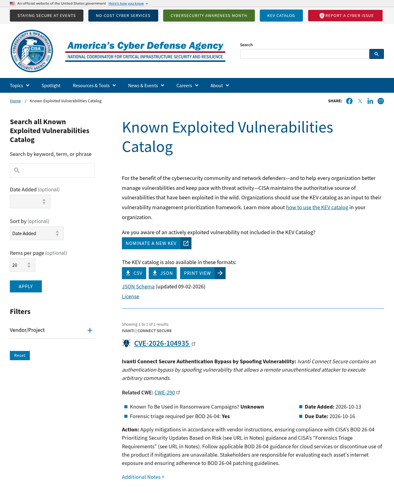
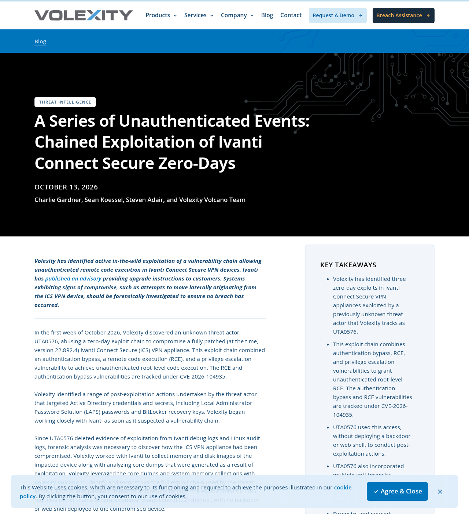
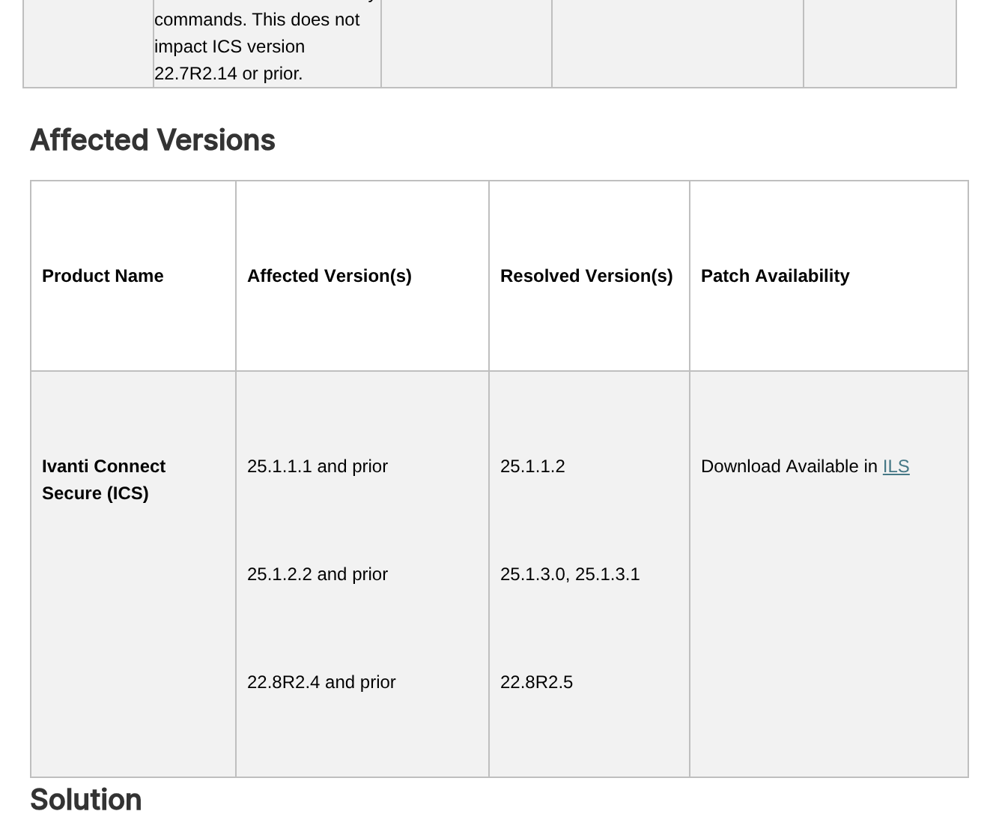
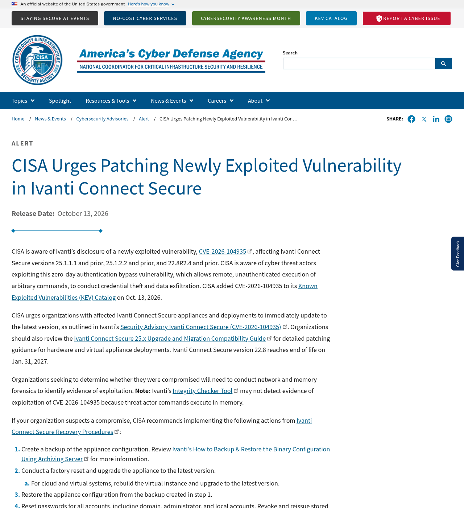
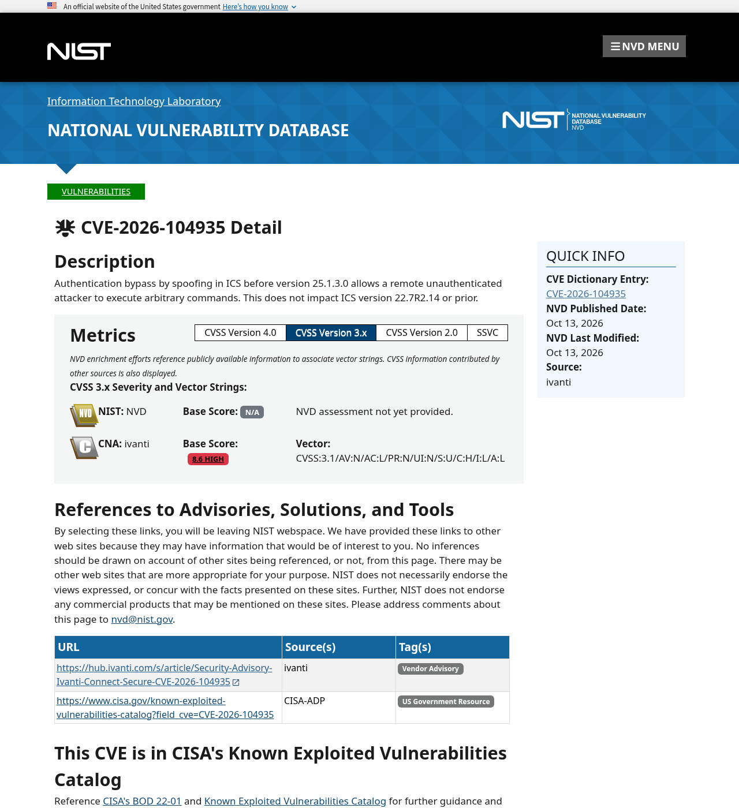

# Ivanti Connect Secure CVE-2026-104935 (posted 2026-10-14)

**Live thread:** https://x.com/P7RIM3/status/2110446654126281207

## Post 1 (image: 05-kev.png)

Ivanti Connect Secure has another zero-day. CVE-2026-104935 is an auth bypass that lets someone with no login run commands on the VPN box. It was exploited before the patch existed, and CISA added it to KEV the same day. Receipts 🧵

## Post 2 (image: 04-volexity.png)

Volexity found it on an appliance that was fully patched at the time (22.8R2.4). An actor they track as UTA0576 had been exploiting it since Oct 3. They chained the auth bypass and an RCE with a privilege escalation to get root. That root bug still has no patch.
https://www.volexity.com/blog/2026/10/13/a-series-of-unauthenticated-events-chained-exploitation-of-ivanti-connect-secure-zero-days/

## Post 3 (image: 01-ivanti-advisory-v2.png)

Affected: 25.1.1.1 and earlier, 25.1.2.2 and earlier, 22.8R2.4 and earlier. Fixed: 25.1.1.2, 25.1.3.0/25.1.3.1, 22.8R2.5. 22.7R2.14 and earlier aren't affected. CVSS 8.6 per Ivanti.
https://hub.ivanti.com/s/article/Security-Advisory-Ivanti-Connect-Secure-CVE-2026-104935

## Post 4 (image: 02-cisa-alert.png)

Here's the part that matters if you run these. CISA says Ivanti's Integrity Checker may not catch it because the attacker's commands run in memory. A clean scan doesn't mean you're clean, so patch and then do the forensics. How many orgs are still running 22.8?
https://www.cisa.gov/news-events/alerts/2026/10/13/cisa-urges-patching-newly-exploited-vulnerability-ivanti-connect-secure

## Other sources checked
- NVD: https://nvd.nist.gov/vuln/detail/CVE-2026-104935 

- CISA KEV: https://www.cisa.gov/known-exploited-vulnerabilities-catalog?field_cve=CVE-2026-104935

Note: Post 2 as published dropped "(both covered by this CVE)" for length.
